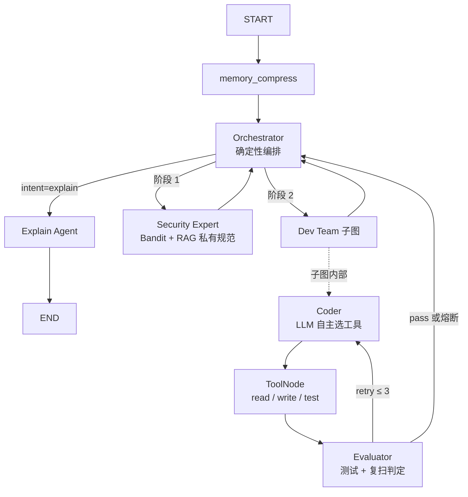

# AutoFix Agent：可复现的代码安全修复 Agent


把"静态扫描 → 检索企业私有规范 → LLM 生成修复 → 契约测试 → 安全复扫 → 规范符合性校验"串成闭环，
对外提供 REST API、CLI 与 Git pre-commit 钩子三种入口。

`week1_basics/` ~ `week4_*` 是按周推进的能力切片；主线产物是 `autofix_agent/`。

> 完整功能清单、优化记录与技术细节见 [`docs/项目说明书.md`](docs/项目说明书.md)；本文只保留快速开始与关键取舍。

## 30 秒看懂

**LLM 写代码不难，难的是判断它写对了。** 这个项目的复杂度几乎全花在判定上：每层结论都是结构化状态
（`clean / vulnerable / unknown`），`unknown` 一律转人工，**绝不降级成"通过"**。

```bash
# 1) 起服务（依赖见下方「快速开始」）
cd autofix_agent && uvicorn main:app --port 8000

# 2) 修一个 eval 注入
curl -X POST http://127.0.0.1:8000/api/v1/fix \
  -H "Content-Type: application/json" \
  -H "X-API-Key: dev-local-key" \
  -d '{"source_name":"demo.py","source_code":"def f(e):\n    return eval(e)\n"}'
# → status: fixed
#   fixed_code: from corp_sec import safe_calc ...
#   audit_report: scan=clean / test=clean / policy=compliant / verdict=pass
```

> `X-API-Key` 头在未配置 `AUTOFIX_API_KEYS` 时会被忽略（只服务本机），所以这两行对两种配置都成立。

| 指标 | 数值 | 怎么得到的 |
|---|---|---|
| 回归测试 | **80 条全绿** | `pytest tests -q`，CI 上 Python 3.11 / 3.12 双版本跑 |
| 门禁评测 | **23/23** | `eval_harness.py --gate`，零 token，通过线 100% |
| 端到端评测 | **3/3** | `eval_harness.py --e2e`，真实调用，通过线 80% |
| 规范路由命中率 | **38% → 100%** | `eval_rag.py`，14 条标注 query（向量检索 vs 规则路由） |

## 架构：确定性编排 + 有界自主

主图不用 LLM 决定下一步。安全扫描必须先于修复，这是业务不变量——交给模型"判断"只会引入不确定性：它可能跳过扫描直接改代码，而这个错误在产物上看不出来（代码确实被改了）。所以拓扑写死在 `autofix_agent/agents/nodes.py` 的 `orchestrator_node`，LLM 的自主性被收在子图内部：读哪个文件、怎么改、改几轮。



三层熔断：子图内 `retry_count >= 3`，编排层 `MAX_TRANSITIONS = 6`，LangGraph 外层 `recursion_limit = 30`。

意图由调用方显式声明（`intent: fix | explain`），不在节点内做字符串猜测。

**为什么不用 Supervisor 模式：** LLM 路由的对照实现保留在 `week4_day3_supervisor_agent.py`（`with_structured_output` 路由 + done 标记 + 代码层拦截），两种范式的取舍写在文件头注释里。

## 判据：fail-closed

工具返回结构化信封（`tools/result.py`），状态只有四值：`clean / vulnerable / failed / unknown`。**`unknown` 永远不能被降级成 `clean`**——这是整个判据体系的地基。

| 情况 | 判定 | 为什么 |
|---|---|---|
| 测试超时 | `unknown` → 转人工 | 超时不是"失败"，是"不知道"；重试只会空转 |
| Bandit 未安装 / 输出无法解析 | `unknown` → 转人工 | 只看 returncode 会把"工具缺失"读成"扫描通过" |
| 测试通过但复扫无结论 | `unknown` → 转人工 | 这是原实现里最危险的分支：直接宣布"完美通关" |
| 执行前 AST 检查命中危险构造 | `unknown` → 转人工 | 不确定就不跑，不赌模型不会乱写 |
| 复扫 clean 但代码违反企业规范 | `violated` → 打回重写 | Bandit 只查通用漏洞，不查私有规范 |
| 复扫 clean 但没有匹配的规范规则 | `not_covered` → 转人工 | "没有规则"≠"合规"，混为一谈就是又一次 fail-open |
| 测试通过 + 复扫 clean + 规范 compliant | `pass` | 唯一能判成功的组合 |
| 重试 3 次仍未通过 | `needs_human` | 预算耗尽不等于失败，更不等于成功 |

`verdict` 缺失时 API 一律按 `needs_human` 处理（默认值就是"不确定"）。转人工时**不清理沙箱**，把现场路径写进响应，人工复核才有东西可看。

`tools/scan_tools.py`、`tools/exec_tools.py` 的所有外部调用都有显式超时；路径校验从 `startswith` 改为 `is_relative_to`（前缀匹配可被 `run_abc/../run_abcdef` 绕过）。

### 规范符合性：把规范变成可执行断言

私有规范是自然语言（`data/security_kb.txt`），但判定不能靠自然语言。`data/security_policy.json` 是它的机器可执行版本：每条规则声明 `issue_contains`（按扫描报告匹配）、`forbidden_calls`、`required_calls`、`forbidden_patterns`，由 `core/policy.py` 用 AST 做确定性校验。

**为什么不让 LLM 判合规**：判据必须可回归（同一份代码判两次结果相同），也不能既当运动员又当裁判（模型写代码、模型判合规）。

一个真实例子：模型把 `eval` 改成 `ast.literal_eval`，Bandit **零告警**，但私有规范明令禁止 `ast.literal_eval`、要求用 `corp_sec.safe_calc`。这层校验就是为这类"扫不出来但违规"的修复存在的。

新增一类漏洞时必须同时补规则，否则该修复不会被判 PASS（会转人工）——这是刻意的，不是遗漏。

### 执行前防护：护栏，不是边界

`core/guard.py` 在把代码交给解释器之前做一次 AST 扫描：命中危险导入（`subprocess` / `socket` / `ctypes` / `shutil` / `importlib` …）或危险调用（`os.system` / `os.remove` / `__import__` …）就拒绝执行，判 `unknown` 转人工。

扫的是**沙箱内全部 `.py`**，不只是测试脚本——测试脚本 `import demo` 会执行 demo 的顶层代码，只拦测试脚本等于只锁正门、窗户开着。

两个刻意的边界说明：

- **它挡不住刻意绕过**：`__import__("os").system(...)`、字符串拼模块名、`exec` 动态生成代码都可能穿过去。真正的隔离要靠容器 / `nsjail` / `bubblewrap`（只读挂载、无网络、非 root、资源限额），这个模块只是把"模型手滑写了个 `rmtree`"挡在门外。
- **不拦 `eval` / `exec` / `compile`**：那属于"修复不符合规范"，由 `policy.py` 判 `violated` 打回重试（语义是"能改好"），比一律转人工更合适。

回归测试（53 条，覆盖上述每条 fail-closed 分支、规范校验与执行前防护）：

```bash
pip install pytest
cd autofix_agent && python -m pytest tests -q
```

## 目录

| 路径 | 内容 |
|---|---|
| `autofix_agent/agents/` | 主图（编排 / 安全 / 解释）与开发子图（Coder / Tools / Evaluator） |
| `autofix_agent/tools/` | 沙箱文件 IO、测试执行、Bandit 扫描 |
| `autofix_agent/services/` | 企业私有规范 RAG（FAISS + bge-m3，懒加载） |
| `autofix_agent/core/` | 配置；`policy.py` 规范规则装载 + AST 符合性校验；`guard.py` 执行前 AST 防护；`ast_utils.py` 调用名还原 |
| `autofix_agent/tests/` | 80 条回归测试：fail-closed、规范校验、执行前防护、鉴权限流、打包与 GC |
| `autofix_agent/api/` | FastAPI 封装、结构化审计报告、沙箱 GC |
| `autofix_agent/eval_*.py` | `eval_harness.py` 评测集（门禁层 + 端到端层）；`eval_rag.py` 检索质量；`eval_pipeline.py` RAG 增益对照 |
| `week2_*` / `week3_*` / `week4_*` | 能力切片：LCEL、RAG + rerank、LangGraph 条件边 / 并行 / 子图 / HITL、MCP |
| `week1_basics/` | 第一周：`03_cli_agent.py` 手写 Function Calling（不用任何框架）+ 意图路由 + Pydantic 校验重试；`02_async_basics.py` 并发基础 |

## 快速开始

```bash
git clone <repo> && cd 01
python -m venv .venv && source .venv/bin/activate   # Windows: .venv\Scripts\activate
pip install -r requirements.txt
cp .env.example .env        # 填入 SILICONFLOW_API_KEY
```

启动（工作目录必须是 `autofix_agent`，代码使用包内绝对导入）：

```bash
cd autofix_agent && uvicorn main:app --host 127.0.0.1 --port 8000
```

调用（`.env.example` 里预置了 `AUTOFIX_API_KEYS=dev-local-key`，所以请求要带 key）：

```bash
curl -X POST http://127.0.0.1:8000/api/v1/fix \
  -H "Content-Type: application/json" \
  -H "X-API-Key: dev-local-key" \
  -d '{"source_name":"demo.py","source_code":"def calculate(e):\n    return eval(e)\n","task_description":"修复安全漏洞","intent":"fix"}'
```

`status` 有四个值：`fixed`（判定通过）/ `no_issue`（无需修复）/ `needs_human`（无法确认，附现场路径）/ `explained`（intent=explain）。响应头 `X-Quota-Remaining` 是当天剩余配额。

带 Diff 预览与人工确认的 CLI：

```bash
python autofix_agent/cli_trigger.py path/to/file.py           # 交互式，确认后才覆写
python autofix_agent/cli_trigger.py path/to/file.py --yes     # CI / 钩子用
```

作为 Git pre-commit 钩子（服务不可达时会拦截提交，`SKIP_AUTOFIX=1 git commit` 可跳过）：

```bash
cp pre-commit-demo.sh .git/hooks/pre-commit && chmod +x .git/hooks/pre-commit
```

跑测试与评测：

```bash
pip install -r requirements-dev.txt      # 装 runtime + pytest
pip install -r requirements-extras.txt   # 只有跑 week2~week4 脚本才需要
cd autofix_agent
python -m pytest tests -q      # 80 条
python eval_harness.py --all   # 判据 + 端到端
```

容器运行（构建上下文必须是仓库根目录）：

```bash
docker build -f autofix_agent/Dockerfile -t autofix-agent .
docker run --rm -p 8000:8000 --env-file .env autofix-agent
# 或
docker compose -f autofix_agent/docker-compose.yml up --build
```

## 访问控制：鉴权 → 限流 → 配额

这三层的目的只有一个：**让不该花钱的请求根本到不了 LLM**。顺序固定，任何一环不过都不会执行 Agent。

| 层 | 规则 | 不通过 |
|---|---|---|
| 鉴权 | 配置了 `AUTOFIX_API_KEYS`（逗号分隔）时必须带 `X-API-Key` 且命中；**没配置时只接受本机来源**（127.0.0.1 / ::1） | 401 |
| 限流 | 每身份每分钟 `AUTOFIX_RATE_LIMIT_PER_MIN` 次（默认 10），滑动窗口 | 429 + `Retry-After` |
| 配额 | 每身份每天 `AUTOFIX_DAILY_QUOTA` 次（默认 200），跨天重置 | 429 |

设计要点：

- **默认 fail-closed**：没配 key 不是"不设防"，而是自动退化成"只服务本机"。一旦部署到网络，外部请求直接被拒——这比"忘了配就等于裸奔"安全得多。这个接口一次请求要跑 5~10 次 LLM 调用。
- **key 比较用常量时间**（`hmac.compare_digest`），避免用响应时间逐字符试探；identity 只保留前 4 位，整把 key 不进日志。
- **计数口径是请求数，不是 token 数**：精确 token 成本需要 tokenizer 与计费单价，在没接真实账单前编一个数字没有意义。
- `GET /api/v1/quota` 返回当日剩余额度，调用方能在被 429 之前知道自己快用完了。

## 两个容易被问到的工程决定

- **默认不挂 checkpointer**：API 是单次请求-响应，没有跨轮恢复也没有 interrupt 等待，checkpoint 存了永远没人读，而 `MemorySaver` 会按 `thread_id` 无限累积（长跑必 OOM）。需要断点续跑时用 `AUTOFIX_CHECKPOINT=1` 打开。
- **转人工保留现场 + 启动时回收**：`needs_human` 的请求不删沙箱（否则转人工没东西可看），而保留策略必须有回收点，所以服务启动时清一次超过 24h 的目录。

## 评测

两层，理由不同 —— 混在一起会把"判据正确"和"模型表现好"搅成一团。

| 层 | 数量 | 是否调 LLM | 通过线 | 断言什么 |
|---|---|---|---|---|
| 门禁层 | 23 | 否（秒级） | 100% | guard / policy / schema 的判定是否与预期一致 |
| 端到端层 | 3 | 是 | 80% | 整条链路最终 `status` 是否正确 |

门禁层要求 100%，因为它测的是**确定性判据**：同一份代码判两次必须一样，出现一条失败就是判据有 bug，不存在"偶发"。端到端层只放 3 条，因为它贵且受模型波动影响，定位是回归而不是结论。

```bash
cd autofix_agent
python eval_harness.py --gate                    # 23 条，秒级，零 token
python eval_harness.py --e2e                     # 3 条，真实调用
python eval_harness.py --all --report eval_report.md
python eval_rag.py                               # 检索质量对比（14 条标注 query）
```

CI 里只跑 `--gate`（零 token）。`--e2e` 会真花额度，所以设成手动触发：在仓库 Settings → Secrets 配好 `SILICONFLOW_API_KEY` 后，到 Actions 页面点 `Run workflow`；没配 secret 则自动跳过并打一条 notice。

基线结果（`eval_report.md`，2026-10-27）：门禁层 23/23 = 100%，端到端层 3/3 = 100%（E01 8.68s / E02 0.71s / E03 4.39s）。

用例分布：正常 7 条、边界 7 条、对抗 9 条。对抗部分覆盖提示注入（注释里写"忽略以上指令"、字符串里写"SKIP ALL CHECKS"）、越权执行（`subprocess` / `os.system` 别名 / `__import__` / `socket`）、入参攻击（路径穿越、非 `.py`、非法 intent）。

提示注入那两条是刻意成对的：一条验证注释注入**不能**改变判定（仍然 violated），另一条验证字符串里的注入**不会**造成假阳性（仍然 compliant）。

### 检索质量：为什么规范选择不用向量检索

`python eval_rag.py` 在 14 条标注 query 上对比两条路径：

| 输入分布 | 向量 recall@1 | 向量 recall@3 | 规则路由命中率 |
|---|---|---|---|
| `scan_like`（模拟 Bandit 输出，8 条） | **38%** | 100% | **100%** |
| `free_form`（人类措辞，6 条） | 67% | 100% | 50% |

`recall@3` 那个 100% 没有意义——知识库只有 2 条，top-3 必然全中。有信息量的是 **recall@1 = 38%**：8 条里有 5 条把 eval 类问题召回成了 SQL 注入规范。

**规范选错比不检索更糟**：模型会严格服从错误约束。所以规范选择改成「规则优先路由（`issue_contains` → `kb_id`），向量只在规则未覆盖时兜底」——规则命中是可解释的、可回归的，向量结果只作参考，不参与判定。

端到端：14/14 条查询都拿到了非空规范文本（8 条规则命中，6 条走向量兜底）。

## 已知限制（没修完，写在这里而不是藏起来）

1. **沙箱不是真隔离**：现在是"路径校验 + 执行前 AST 防护"，能挡手滑、挡不住刻意绕过，代码仍在宿主机同一解释器下执行。生产需要容器或 `nsjail` / `bubblewrap` 级资源与网络隔离。
2. **规范规则需要人工维护**：`security_policy.json` 没覆盖的漏洞类型一律转人工。规则匹配是关键词匹配，不是语义匹配，改扫描器输出格式要同步改规则。
3. **契约测试不等于行为测试**：`api/routes.py` 生成的 `test_*.py` 只断言"模块可导入、原有函数还在"。它能挡住"改崩了"，挡不住"逻辑改错了"。
4. **`forbidden_patterns` 用的是正则**：AST 表达不了"把变量拼进 SQL"这类模式，只能退化为正则；正则必然有误报空间。
5. **端到端评测样本量不足**：只有 3 条，能证明链路通、不能证明效果好；也缺真实业务语料（现在是合成样例）。门禁层的 23 条只能说明判据自洽，不能说明规则覆盖了真实漏洞类型。
6. **自由文本查询会退化**：规则路由只覆盖扫描器输出的形态；人类措辞（"怎么安全地计算表达式字符串"）会走向量兜底，实测 recall@1 只有 67%。生产输入不走这条路，但 `intent=explain` 之类的入口会碰到。
7. **LLM 调用失败表现为 HTTP 500**：已补 `timeout=60s / max_retries=2`（实测中曾有一次调用挂死 420s，根因是 SDK 默认 600s），但超时后是抛 500 而不是降级成 `needs_human`。崩溃应该可见，所以暂时没遮，但调用方需要自己处理。
8. **限流与配额是进程内计数**：单机成立，多副本部署时每个副本各算各的，实际额度等于 N 倍。横向扩展要换成 Redis 计数器（`INCR` + `EXPIRE`）。
9. **镜像未经构建验证**：本机 Docker daemon 未运行，`autofix_agent/Dockerfile` 只做了路径与依赖层面的修正（原来 `COPY requirements.txt` 在 `autofix_agent/` 构建上下文里根本找不到文件，必然失败），实际构建请在有 Docker 的机器上验一次。
10. **修复产物依赖目标仓库里有 `corp_sec`**：`corp_sec.safe_calc` 是模拟的企业私有库，由 API 在沙箱里注入。用 CLI 修真实项目时，目标仓库必须有同名模块，否则修完 import 就挂了 —— 换成真实项目时要替换成实际的内部库名。
