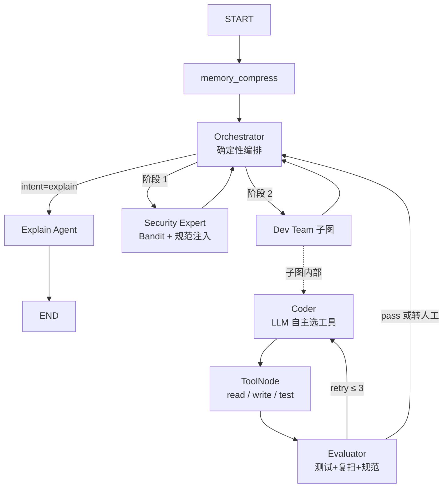

# AutoFix Agent 项目说明书

> 版本：2026-10-27　｜　对应代码：仓库当前 `HEAD`（`autofix_agent/`，3586 行 Python）
> 本文所有描述均以实际代码为准；标注「未验证」的部分是客观未完成项，不是谦虚。

---

## 一、功能清单

### A. 核心修复链路

| # | 功能点 | 作用 | 代码位置 |
|---|---|---|---|
| A1 | 单文件漏洞自动修复 | 输入源码 + 自然语言诉求，输出修复后代码、结构化审计报告、终态判定。一次请求完成"扫描→检索规范→改码→测试→复扫→合规校验"全闭环 | `api/routes.py: fix_code` |
| A2 | 代码解释模式 | `intent=explain` 走单节点分支，只解释代码不修改文件，返回 `status=explained` | `agents/nodes.py: explain_agent_node` |
| A3 | 确定性编排 | 用固定顺序（安全扫描 → 开发修复）驱动流程，而非让 LLM 决定拓扑。安全扫描必须先于修复是业务不变量，交给模型判断会产生"跳过扫描直接改码"且产物上看不出来的错误 | `agents/nodes.py: orchestrator_node` |
| A4 | 有界自主 | 三层熔断：子图重试 3 次、编排转移 6 次、LangGraph `recursion_limit=30`。防止 Agent 无限循环烧钱 | `dev_subgraph.py` / `nodes.py` / `routes.py` |
| A5 | 安全扫描工具化 | 把 Bandit 封装成 Agent 可调用的工具，输出结构化结果（文件级告警明细），而非人类可读字符串 | `tools/scan_tools.py` |
| A6 | 企业规范检索 | 按扫描结果匹配规则 → 取出对应的私有规范条目注入提示词，让模型按企业标准修而不是按通用经验修 | `services/rag_service.py: retrieve_for_scan` |
| A7 | 开发子图 | Coder（LLM 自主选工具）/ ToolNode（读、写、测）/ Evaluator（判定）三节点闭环，独立于主图 | `agents/dev_subgraph.py` |
| A8 | 契约测试自动生成 | 用 AST 提取原文件顶层函数名，生成带断言（函数存在且可调用）的 `test_*.py`，能挡住"改崩了/改丢函数" | `api/routes.py: _build_contract_test` |
| A9 | 代码强制格式化 | 输出前用 Black 格式化，失败则回退原始代码并记录 | `api/routes.py` |
| A10 | 结构化审计报告 | 返回"发现了什么漏洞 / 是否用了 RAG / 契约测试结果 / 复扫结果 / 规范符合性 / 终态判定"六项，可直接入库审计 | `api/schemas.py: AuditDetails` |

### B. 判定与防护

| # | 功能点 | 作用 | 代码位置 |
|---|---|---|---|
| B1 | 结构化工具结果 | 所有工具返回 JSON 信封，状态只有 `clean / vulnerable / failed / unknown` 四值。杜绝"改一个字就静默改变控制流"的字符串嗅探 | `tools/result.py` |
| B2 | fail-closed 判定 | `unknown`（工具挂了 / 超时 / 输出无法解析）一律转人工，**绝不降级成通过**。只有"契约测试 clean + 复扫 clean + 规范 compliant"三项齐了才判 `pass` | `agents/dev_subgraph.py: evaluate_node` |
| B3 | 规范符合性校验 | 把企业规范声明成数据（`forbidden_calls / required_calls / forbidden_patterns`），用 AST 做确定性校验。抓的是"Bandit 零告警但违反规范"的修复（如 `ast.literal_eval`） | `core/policy.py` + `data/security_policy.json` |
| B4 | 执行前 AST 防护 | 代码交给解释器前扫描危险导入（`subprocess/socket/ctypes/shutil/...`）与危险调用（`os.system/os.remove/__import__/...`），命中即拒绝执行并转人工 | `core/guard.py` |
| B5 | 路径隔离 | 所有文件 IO 与执行都限制在请求专属沙箱目录内；用 `is_relative_to` 而非 `startswith`（前缀匹配可被 `run_abc/../run_abcdef` 绕过） | `tools/file_tools.py` |
| B6 | 入参校验 | `source_name` 走正则白名单（挡路径穿越）、必须为合法模块名、源码上限 200k 字符、`intent` 用 `Literal` 约束 | `api/schemas.py` |
| B7 | 原子写入 | 先写 `.tmp` 再 `replace`，进程中途崩溃不会留下半截源码 | `tools/file_tools.py: write_sandbox_file` |
| B8 | 转人工保留现场 | `needs_human` 时**不清理沙箱**，把目录路径写进响应。转了人工却没有现场等于没转 | `api/routes.py` |

### C. 服务化

| # | 功能点 | 作用 | 代码位置 |
|---|---|---|---|
| C1 | REST API | `POST /api/v1/fix` 修复、`GET /api/v1/quota` 查额度、`GET /health` 健康检查 | `api/routes.py` / `main.py` |
| C2 | 鉴权 | 配置了 `AUTOFIX_API_KEYS` 则校验 `X-API-Key`（常量时间比较）；**未配置时只接受本机来源**——暴露到公网自动关闭，而不是"忘了配等于不设防" | `core/auth.py` |
| C3 | 限流 | 按身份分桶的滑动窗口，默认 10 次/分钟，超限返回 429 + `Retry-After` | `core/limits.py: SlidingWindow` |
| C4 | 每日配额 | 按身份每天 N 次（默认 200），跨天重置；响应头 `X-Quota-Remaining` 告知剩余 | `core/limits.py: DailyQuota` |
| C5 | 沙箱回收 | 服务启动时清理超过 24h 的历史沙箱目录，只清"时间戳命名"的自身产物，不碰人工文件 | `core/sandbox_gc.py` |
| C6 | 可选断点续跑 | 默认不挂 checkpointer（单次请求-响应，存了没人读且会累积）；`AUTOFIX_CHECKPOINT=1` 可开启 | `agents/main_graph.py` |
| C7 | 可观测（可选） | 有 Langfuse key 时自动挂 CallbackHandler 追踪全链路；无 key 自动跳过不影响主流程 | `api/routes.py` |
| C8 | 错误分级 | LLM 超时/连接失败 → 503 + `Retry-After`；上游限流 → 429；其余 → 500 | `api/routes.py` |

### D. 工程化交付

| # | 功能点 | 作用 | 代码位置 |
|---|---|---|---|
| D1 | CLI 工具 | 单文件修复 + Diff 预览 + 人工确认后才覆写；退出码语义化（0 通过 / 1 未通过） | `cli_trigger.py` |
| D2 | pre-commit 钩子 | 提交前对暂存的 `.py` 逐个过一遍修复检查，未通过则拦截；服务不可达也拦截（附 `SKIP_AUTOFIX=1` 逃生口） | `pre-commit-demo.sh` |
| D3 | 门禁评测集 | 23 条确定性用例（正常 7 / 边界 7 / 对抗 9），零 token、秒级，通过线 100% | `eval_harness.py --gate` |
| D4 | 端到端评测 | 3 条真跑 LLM 的链路用例，通过线 80% | `eval_harness.py --e2e` |
| D5 | 检索质量评测 | 14 条标注 query，对比"向量检索直接路由"与"规则路由"的命中率 | `eval_rag.py` |
| D6 | 回归测试 | 80 条 pytest，覆盖判定链、防护、鉴权限流、打包与 GC | `tests/` || D7 | 容器化 | Dockerfile + compose（构建上下文指向仓库根） | `Dockerfile` / `docker-compose.yml` |

---

## 二、实施的优化项

按"问题 → 改进 → 证据"组织。所有数字都来自实际运行，不是估算。

### 优化 1：把 fail-open 改成 fail-closed

- **问题**：原实现用字符串标记判定（`"✅ 测试通过" in msg`）。Bandit 未安装时返回 `"工具异常：..."`，不含 `❌`，被上层读成"无漏洞"，直接输出"✅ 漏洞已彻底修复，完美通关"——**扫描器坏了，系统宣布成功**。
- **改进**：引入结构化信封（`Status` 四值），任何"没拿到结论"的路径统一归 `unknown`，判定链遇 `unknown` 转人工。
- **证据**：`test_scan_missing_bandit_is_unknown`、`test_evaluator_scan_unknown_never_passes` 等钉住；新增用例在旧实现下会失败。

### 优化 2：把"假测试"换成契约测试

- **问题**：自动生成的测试只有 `import demo`，`returncode=0` 仅证明"能导入"，"测试通过"不构成任何证据。
- **改进**：用 AST 提取原文件顶层函数，生成"函数存在且可调用"的断言；同时在代码注释与文档中明确它是契约测试、不是行为测试，通过标准必须叠加扫复扫。
- **证据**：`_build_contract_test`；README 已知限制第 3 条主动声明能力边界。

### 优化 3：补上"规范符合性"这一层判据

- **问题**：PASS 判据原为"契约测试 + Bandit"，但 Bandit 只查通用漏洞。实测中模型给出 `ast.literal_eval`（企业规范明令禁止、要求 `corp_sec.safe_calc`），Bandit **零告警**，于是被判 PASS。
- **改进**：把规范声明成数据，用 AST 做确定性校验；四值结论 `compliant / violated / not_covered / unknown`，**只有 compliant 能通向 PASS**，`not_covered`（没规则）也转人工——"没规则"≠"合规"。
- **证据**：`test_policy.py` 15 条；`test_ast_literal_eval_is_violated` 正是上述实测场景。

### 优化 4：修掉两处可绕过的路径校验

- **问题**：`startswith` 前缀匹配 —— `sandbox/run_abc/../run_abcdef/x.py` 解析后前缀相同会被放行；API 层 `run_dir / req.source_name` 完全没校验，构造 `../../x.py` 可在进入沙箱校验**之前**写到磁盘任意位置。
- **改进**：改用 `is_relative_to`；API 层加正则白名单 + 模块名合法性校验；配置缺失时直接失败而不是退回 cwd。
- **证据**：`test_sandbox_prefix_bypass_is_rejected`、`test_source_name_rejects_traversal`（复现过的绕过用例已固化为测试）。

### 优化 5：判定从"嗅探文本"改为"按工具名分派"

- **问题**：Evaluator 靠 `"❌" in content and "测试失败" in content` 判断，改个提示文案就静默改变控制流；且批量工具调用时只看最后一条消息，前面的失败被忽略。
- **改进**：用 `ToolMessage.name` 分派，忽略无法识别的工具结果（转人工）。
- **证据**：`dev_subgraph.py` 中 `tool_name` 分支。

### 优化 6：规范选择从向量检索改为规则路由

- **问题**：纯向量检索（bge-m3，k=3）在 Bandit 输出上 top-1 命中率只有 38%，8 条里 5 条把 eval 类问题召回成 SQL 注入规范。**规范选错比不检索更糟**——模型会严格服从错误约束。
- **改进**：规则优先路由（`issue_contains` → `kb_id` → 知识库条目），向量只在规则未覆盖时兜底且标注"仅供参考，不参与判定"。
- **证据**：`eval_rag.py` 实测——`scan_like` 子集向量 recall@1 = 38%、规则路由 = 100%；`free_form` 子集 67% / 50%（人类措辞会退化，已写入已知限制）。

### 优化 7：给所有外部调用补显式超时

- **问题**：`ChatOpenAI` / `OpenAIEmbeddings` / `subprocess` / `requests` 全部没有超时。实测中端到端评测**卡死 420 秒无响应**，根因是 SDK 默认 600s。
- **改进**：LLM 60s / 重试 2 次，Embedding 30s / 1 次，Bandit 30s，测试执行 20s，HTTP 300s；全部走 `core/config.py` 可配。
- **证据**：补完后同一评测 4 秒内跑完；`test_scan_timeout_is_unknown`、`test_exec_timeout_is_unknown_not_failed`（超时归 `unknown` 而不是 `failed`，因为"不知道"不能当"可以重试"）。

### 优化 8：修掉内存与磁盘的慢性泄漏

- **问题**：① `MemorySaver` 给每个请求留一份永不释放的 checkpoint（`thread_id` 每请求唯一）；② 转人工保留沙箱但没有回收点，实测积了 7 个目录。
- **改进**：① 默认不挂 checkpointer（单次请求-响应本就不需要），需要断点续跑时用环境变量打开；② 新增启动时 GC，只清 24h 以上、时间戳命名的自身目录。
- **证据**：`test_graph_has_no_checkpointer_by_default`、`test_sandbox_gc.py` 3 条。

### 优化 9：依赖清单与可复现性

- **问题**：`requirements.txt` 是 **UTF-16 LE 带 BOM**（工具识别为二进制），且 `openai==3.11.0` 与实际安装的 1.109.1 不符，还缺 `langgraph / fastapi / bandit / black / langfuse` 等——`pip install` 后根本跑不起来。Dockerfile 的 `COPY requirements.txt` 在 `autofix_agent/` 构建上下文里也找不到文件。
- **改进**：重写为 UTF-8 并拆成三份（runtime / dev / extras），版本全部取自实测环境；Dockerfile 构建上下文改指向仓库根；新增 `.env.example`。
- **证据**：`test_packaging.py` 三条断言（import 覆盖、编码无 BOM、默认无 checkpointer）。

### 优化 10：代理环境下的 localhost 误判

- **问题**：环境里配了 `http_proxy` 时，发往 `127.0.0.1` 的请求也会被塞给代理，结果是"服务正常但报 502/连接失败"。企业网络里必踩。
- **改进**：CLI 用 `requests.Session()` 且本地 host 置 `trust_env=False`；钩子用 `build_opener(ProxyHandler({}))`。
- **证据**：修复后错误信息从 `502 Bad Gateway` 变成真实的 `connection refused`，说明探测准了。

### 优化 11：把假钩子做成真钩子

- **问题**：`pre-commit-demo.sh` 把 `$FILE` 传给 `cli_trigger.py`，但后者 `__main__` 写死了 `sandbox/demo.py`，**参数被忽略**；且 `trigger_agent` 永远返回 `None` → 退出码恒 0 → 钩子永远以为通过。
- **改进**：CLI 改 argparse 接收路径与 `--yes`，退出码语义化；钩子加 health check、`SKIP_AUTOFIX` 逃生口，服务不可达时拦截而非静默放行。
- **证据**：`sh pre-commit-demo.sh` 实测无暂存文件 → 0；有暂存但服务未起 → 1 并打印两条出路。

### 优化 12：日志不再输出凭据片段

- **问题**：`03_cli_agent.py` 把 API key 前 6 后 4 位打进日志（`sk-uwg...irjt`）。安全类项目日志出现凭据残片，审计会直接记问题。
- **改进**：只记录"已加载 + 长度"，不输出任何片段。
- **证据**：实测日志变为 `已加载 API Key（长度 51）`。

### 优化 13：消除 `main.py` 同名冲突

- **问题**：根目录 `main.py`（第二周 RAG 服务）与 `autofix_agent/main.py` 同名，`pytest` 下 `import main` 命中了根目录那个，报 `faiss_index` 找不到。
- **改进**：根目录的改为 `week2_rag_api.py`；第一周文件整体迁入 `week1_basics/`。
- **证据**：迁移后 `pytest` 80 passed。

### 优化 14：评测从"不可用"变成"可回归"

- **问题**：原评测每组只跑 1 次（n=1）、裁判与被评是同一个模型、且 prompt 里直接告诉裁判答案；RAGAS 数据集仅 2 条。
- **改进**：拆成两层——门禁层 23 条确定性断言（通过线 100%，因为确定性判据不存在"偶发失败"）、端到端层 3 条真跑（通过线 80%，定位是回归不是结论）。另加检索质量评测（14 条标注 query）。
- **证据**：`eval_report.md` 基线：门禁 23/23、端到端 3/3；`eval_rag.py` 的 38% vs 100% 直接驱动了优化 6 的重构。

---

## 三、项目说明书

### 3.1 项目概述

**AutoFix Agent** 是一个面向 Python 单文件的安全漏洞自动修复 Agent。它把"静态扫描 → 检索企业私有规范 → 由 LLM 生成修复 → 契约测试 → 安全复扫 → 规范符合性校验"串成一条闭环，并对外提供 REST API、CLI 与 Git pre-commit 钩子三种入口。

**设计立场**：LLM 可以写代码，但不能自己给自己发合格证。项目里几乎所有复杂度都花在"如何判定这次修复真的成立"上，而不是"如何让模型写出更好看的代码"。

**非目标**（写在代码注释里，不是事后补充）：
- 不做真正的安全沙箱。当前是"目录隔离 + 路径校验 + 执行前 AST 预检"，能挡手滑，挡不住刻意绕过；真隔离需要容器或 `nsjail`/`bubblewrap`。
- 不承诺 100% 修复率。判定为 `needs_human` 是正常出口，不是失败。

### 3.2 功能模块



| 模块 | 职责 | 关键文件 |
|---|---|---|
| 编排层 | 固定顺序驱动流程、图级熔断、意图分派 | `agents/nodes.py: orchestrator_node` |
| 安全节点 | 调用 Bandit、按规则注入企业规范 | `agents/nodes.py: security_expert_node` |
| 开发子图 | Coder 改码、工具执行、Evaluator 判定 | `agents/dev_subgraph.py` |
| 工具层 | 沙箱读写、测试执行、静态扫描，统一结构化返回 | `tools/` |
| 判定层 | 规范规则装载 + AST 校验、执行前防护、调用名还原 | `core/policy.py` / `guard.py` / `ast_utils.py` |
| 服务层 | REST 接口、鉴权限流配额、沙箱生命周期 | `api/` / `main.py` |
| 检索层 | 知识库解析、规则路由、向量兜底 | `services/rag_service.py` |
| 评测层 | 门禁/端到端/检索质量三套评测 | `eval_harness.py` / `eval_rag.py` |

### 3.3 技术架构

**技术栈**

| 层 | 选型 | 版本 |
|---|---|---|
| 编排 | LangGraph（StateGraph / 子图 / ToolNode） | 1.2.12 |
| 模型接入 | langchain-openai → 硅基流动 OpenAI 兼容接口 | 1.1.9 |
| 默认模型 | `Qwen/Qwen2.5-7B-Instruct`（可环境变量替换） | — |
| 向量 | FAISS + `BAAI/bge-m3` | faiss-cpu 1.15.1 |
| 服务 | FastAPI + uvicorn | 0.143.0 / 0.54.0 |
| 代码工具链 | Black（格式化）、Bandit（静态扫描） | 26.10.1 / 1.9.4 |
| 可观测 | Langfuse（可选） | 5.0.2 |
| 测试 | pytest | 9.1.1 |

**一次请求的数据流**

1. `POST /api/v1/fix` → 鉴权（401）→ 限流（429）→ 配额（429）→ 入参校验（400/422）
2. 创建请求专属沙箱，写入源码、生成契约测试、注入 `corp_sec.py`（模拟企业私有库）
3. 主图执行：`memory_compress → orchestrator → security_expert → dev_team(子图)`
4. 安全节点：Bandit 扫描 → 命中规则 → 注入对应规范条目
5. 子图：Coder 读码 → 写码 → 跑测试 → Evaluator 依次校验（测试 → 复扫 → 规范）
6. 回编排层：`verdict` 决定 `fixed` / `needs_human` / `no_issue`
7. 后处理：Black 格式化、组装审计报告、按 verdict 决定是否回收沙箱

**判定链（这是本项目的核心资产）**

| 层 | 取值 | 不通过时 |
|---|---|---|
| 工具结果 | `clean / vulnerable / failed / unknown` | `unknown` → 转人工 |
| 契约测试 | `clean / failed / unknown` | `failed` → 打回重试 |
| 安全复扫 | `clean / vulnerable / unknown` | `vulnerable` → 打回重试 |
| 规范符合 | `compliant / violated / not_covered / unknown` | `violated` → 打回重试；`not_covered` → 转人工 |
| 终态 | `pass / needs_human / no_issue` | 仅三者齐备才 `pass` |

### 3.4 安装与运行

**环境要求**：Python 3.11+（开发验证环境为 3.13，Dockerfile 基于 3.12-slim）。

```bash
git clone <repo> && cd 01
python -m venv .venv
source .venv/bin/activate          # Windows: .venv\Scripts\activate
pip install -r requirements.txt     # 主项目依赖
cp .env.example .env                # 填入 SILICONFLOW_API_KEY
```

**启动服务**（工作目录必须是 `autofix_agent`，代码使用包内绝对导入）：

```bash
cd autofix_agent
uvicorn main:app --host 127.0.0.1 --port 8000
```

**CLI**

```bash
python autofix_agent/cli_trigger.py path/to/file.py          # 交互式，确认后覆写
python autofix_agent/cli_trigger.py path/to/file.py --yes    # CI / 钩子
python autofix_agent/cli_trigger.py path/to/file.py --intent explain
```

**Git 钩子**

```bash
cp pre-commit-demo.sh .git/hooks/pre-commit && chmod +x .git/hooks/pre-commit
# 跳过某次检查
SKIP_AUTOFIX=1 git commit -m "..."
```

**容器**（未构建验证：开发机 Docker daemon 未运行）

```bash
docker build -f autofix_agent/Dockerfile -t autofix-agent .
docker run --rm -p 8000:8000 --env-file .env autofix-agent
# 或
docker compose -f autofix_agent/docker-compose.yml up --build
```

**测试与评测**

```bash
pip install -r requirements-dev.txt
cd autofix_agent
python -m pytest tests -q                    # 80 passed
python eval_harness.py --gate                # 23 条，零 token
python eval_harness.py --all --report eval_report.md
python eval_rag.py                           # 检索质量对比
```

> 需要跑 `week2_*`~`week4_*` 教学脚本时，额外 `pip install -r requirements-extras.txt`。

### 3.5 配置说明

配置文件为仓库根目录 `.env`（已 gitignore）。全部可用环境变量覆盖。

| 变量 | 必填 | 默认值 | 说明 |
|---|---|---|---|
| `SILICONFLOW_API_KEY` | 是 | — | 模型供应商标识；也接受 `OPENAI_API_KEY` 作为回退 |
| `SILICONFLOW_BASE_URL` | 否 | `https://api.siliconflow.cn/v1` | OpenAI 兼容接口地址 |
| `MODEL_NAME` | 否 | `Qwen/Qwen2.5-7B-Instruct` | 换模型不用改代码 |
| `EMBEDDING_MODEL` | 否 | `BAAI/bge-m3` | 向量模型 |
| `LLM_TIMEOUT_SEC` / `LLM_MAX_RETRIES` | 否 | `60` / `2` | LLM 调用超时与重试 |
| `EMBEDDING_TIMEOUT_SEC` / `_MAX_RETRIES` | 否 | `30` / `1` | 向量调用超时与重试 |
| `AUTOFIX_API_KEYS` | 生产必填 | 空 | 逗号分隔的服务端 key；**留空则只接受本机请求** |
| `AUTOFIX_API_KEY` | 否 | 空 | CLI / 钩子访问服务时携带的 key |
| `AUTOFIX_RATE_LIMIT_PER_MIN` | 否 | `10` | 每身份每分钟请求上限（`0` = 全部拒绝） |
| `AUTOFIX_DAILY_QUOTA` | 否 | `200` | 每身份每日请求上限 |
| `AUTOFIX_CHECKPOINT` | 否 | 不设置 | `1` 时启用 checkpointer（断点续跑调试用） |
| `AUTOFIX_API` / `AUTOFIX_HEALTH` | 否 | `127.0.0.1:8000` | 钩子脚本里的服务地址 |
| `LANGFUSE_PUBLIC_KEY` / `SECRET_KEY` / `HOST` | 否 | 空 | 留空则自动跳过追踪 |

**业务参数（代码内常量，改需改代码）**

| 参数 | 值 | 位置 |
|---|---|---|
| 最大重试次数 | 3 | `core/config.py: MAX_RETRY_COUNT` |
| 编排转移上限 | 6 | `agents/nodes.py: MAX_TRANSITIONS` |
| 单文件大小上限 | 1 MB | `core/config.py: MAX_FILE_SIZE` |
| 源码长度上限 | 200k 字符 | `api/schemas.py` |
| 扫描 / 测试 / 沙箱保留 | 30s / 20s / 24h | 各工具与 `sandbox_gc.py` |

### 3.6 使用示例

**示例 1：修复 eval 注入**

```bash
curl -X POST http://127.0.0.1:8000/api/v1/fix \
  -H "Content-Type: application/json" \
  -H "X-API-Key: dev-local-key" \
  -d '{
    "source_name": "demo.py",
    "source_code": "def calculate(e):\n    return eval(e)\n",
    "task_description": "修复安全漏洞",
    "intent": "fix"
  }'
```

响应（实测）：

```json
{
  "success": true,
  "status": "fixed",
  "message": "【开发部最终汇报】：【Evaluator】测试通过、复扫干净、规范合规。",
  "fixed_code": "from corp_sec import safe_calc\n\n\ndef calculate(expression):\n    return safe_calc(expression)\n",
  "audit_report": {
    "vulnerability_found": "blacklist (MEDIUM) 行 2: Use of possibly insecure function",
    "rag_used": true,
    "tests_passed": true,
    "fix_strategy": "LLM 反思闭环 + 契约测试 + Bandit 复扫 + 规范 AST 校验",
    "scan_status": "clean",
    "test_status": "clean",
    "policy_status": "compliant",
    "verdict": "pass"
  }
}
```

响应头会带 `X-Quota-Remaining`。

**示例 2：只解释不改码**

```bash
curl -X POST http://127.0.0.1:8000/api/v1/fix \
  -H "X-API-Key: dev-local-key" -H "Content-Type: application/json" \
  -d '{"source_name":"demo.py","source_code":"def f(x):\n    return x\n","intent":"explain"}'
```

返回 `status: "explained"`，`fixed_code` 为空，`audit_report` 为 `null`。

**示例 3：查配额**

```bash
curl http://127.0.0.1:8000/api/v1/quota -H "X-API-Key: dev-local-key"
# {"identity":"key:dev-","daily_limit":200,"remaining_today":199,"rate_limit_per_min":10}
```

**状态与错误码**

| 情形 | HTTP | `status` / detail |
|---|---|---|
| 判定通过 | 200 | `fixed` |
| 扫描无漏洞 | 200 | `no_issue`（不返回代码，未做改动） |
| 无法确认（含工具异常、无规范规则、拦住危险代码） | 200 | `needs_human`，message 内含沙箱路径 |
| 只解释 | 200 | `explained` |
| 缺 / 错 key | 401 | `缺少 X-API-Key` / `无效的 X-API-Key` |
| 限流、配额耗尽、上游限流 | 429 | 附带 `Retry-After` |
| 文件名非法 / 超长 | 400 / 422 | 字段级错误 |
| 模型服务超时 / 不可达 | 503 | 附带 `Retry-After: 5` |
| 其他崩溃 | 500 | `Agent 执行崩溃: ...` |

### 3.7 目录结构

```
01/
├── autofix_agent/              # 主项目
│   ├── agents/                 # 主图、节点、开发子图
│   ├── api/                    # 路由与请求/响应模型
│   ├── core/                   # 配置、鉴权、限流、规范校验、执行前防护、GC
│   ├── data/                   # 规范知识库（自然语言）+ 规则（机器可执行）
│   ├── services/               # 规范检索
│   ├── tools/                  # 沙箱 IO、测试执行、Bandit、结构化结果
│   ├── tests/                  # 80 条回归测试
│   ├── eval_harness.py         # 门禁 + 端到端评测
│   ├── eval_rag.py             # 检索质量评测
│   ├── cli_trigger.py          # CLI
│   ├── main.py                 # FastAPI 入口
│   ├── Dockerfile / docker-compose.yml
├── week1_basics/               # 第一周：手写 Function Calling 等
├── week2_*.py ~ week4_*.py     # 按天推进的能力切片
├── docs/                       # 本说明书
├── requirements*.txt           # runtime / dev / extras
├── pre-commit-demo.sh
└── README.md                   # 快速开始与已知限制
```


**测试分布（80 条）**

| 文件 | 条数 | 覆盖 |
|---|---|---|
| `test_fail_closed.py` | 25 | 判定链、扫描/执行失败路径、编排熔断、路径绕过、审计提取 |
| `test_policy.py` | 15 | 规范规则匹配、别名导入、必选调用缺失、SQL 拼接、语法错误 |
| `test_security.py` | 14 | 鉴权三种情形、滑动窗口、每日配额、接口 401/429 |
| `test_guard.py` | 13 | 危险导入/调用拦截、别名绕过、沙箱级扫描、被拦=UNKNOWN |
| `test_rag_routing.py` | 7 | 规则路由、误命中防护、检索确定性 |
| `test_packaging.py` | 3 | 依赖覆盖、清单编码、默认无 checkpointer |
| `test_sandbox_gc.py` | 3 | 过期回收、不误删人工文件、根目录缺失 |

### 3.8 已知限制

完整列表见 `README.md`「已知限制」，此处摘要：沙箱非真隔离；规范规则需人工维护；契约测试≠行为测试；`forbidden_patterns` 用正则；端到端样本仅 3 条；自由文本检索会退化；限流为进程内计数（多副本失效）；镜像未构建验证；修复产物依赖目标仓库存在 `corp_sec`。
